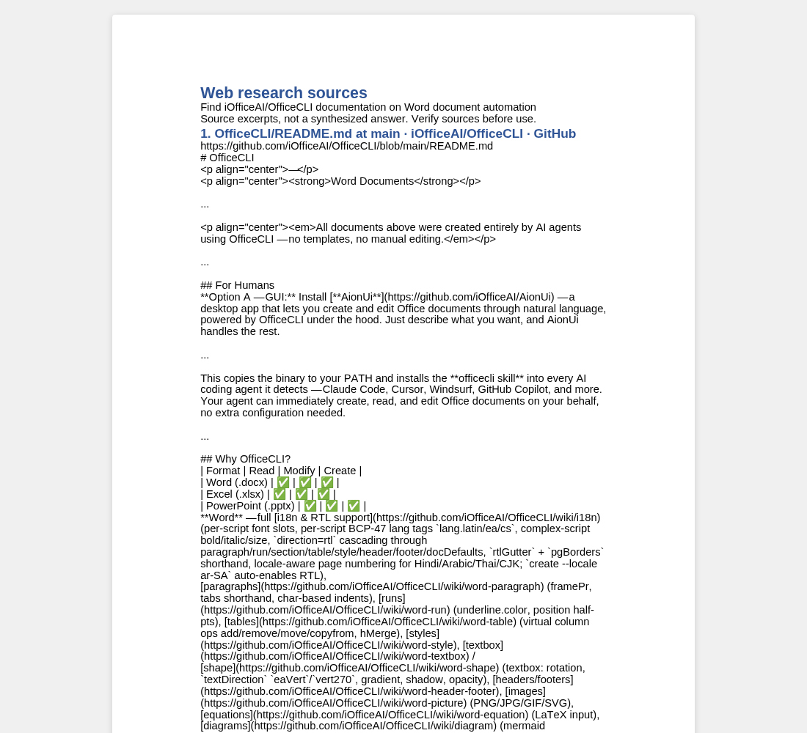

# Web research to a Word report

This standalone Python example combines [Parallel Search MCP](https://docs.parallel.ai/integrations/mcp/search-mcp)
with OfficeCLI to collect web sources into a `.docx` report. Search uses Fast mode
and needs no account or API key. The anonymous endpoint has lower rate limits and
is intended for light use.

The script discovers the MCP tools over Streamable HTTP, calls `web_search`, then
calls `web_fetch` on up to three results by default. It writes source titles, URLs,
and excerpts using `officecli batch`. This is a deterministic source collection
pipeline, with no language model or agent loop. It does not summarize or verify
the sources. When a page cannot be fetched, the report labels the failure and uses
its search excerpts.

## Run

Install [OfficeCLI](../../README.md#installation), make sure `officecli --version`
works on your PATH, and use Python 3.10 or newer. From the repository root:

```bash
python3 -m venv /tmp/officecli-research-env
/tmp/officecli-research-env/bin/python -m pip install -r examples/mcp/requirements.txt
/tmp/officecli-research-env/bin/python examples/mcp/research-report.py \
  "Find iOfficeAI/OfficeCLI documentation on Word document automation" \
  --query "site:github.com/iOfficeAI/OfficeCLI Word document automation" \
  --output /tmp/research-report.docx
officecli view /tmp/research-report.docx text
officecli view /tmp/research-report.docx html -o /tmp/research-report.html
```

On Windows, create the environment in a directory of your choice and use
`<venv>\Scripts\python.exe` instead of `<venv>/bin/python`.

Repeat `--query` to provide related queries. Use `--max-sources 1` through
`--max-sources 5` to adjust the number of pages fetched. Existing output files
are rejected. Transport errors, rate limits, and document command failures stop
the script; it does not retry automatically. A document command failure can leave
a partial output file, which should be removed before trying again.

Unlike the format showcase examples, this example has one Python entry point and
a dependency file because it also calls a remote MCP service. The included
[sample report](research-report.docx) and screenshot show one run; results vary
as the web changes.


